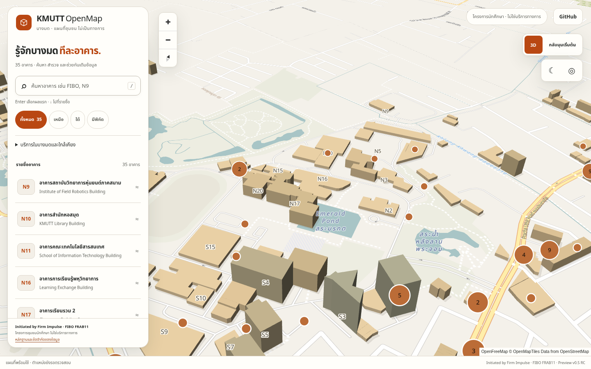
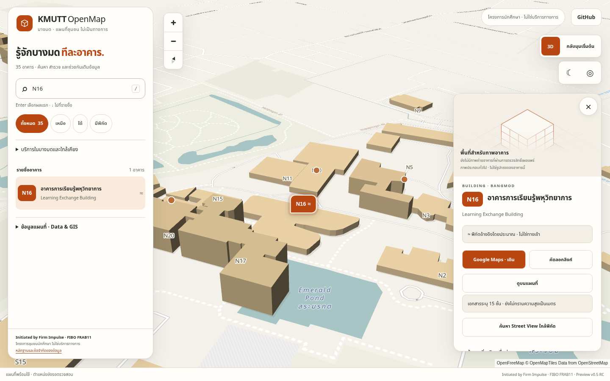
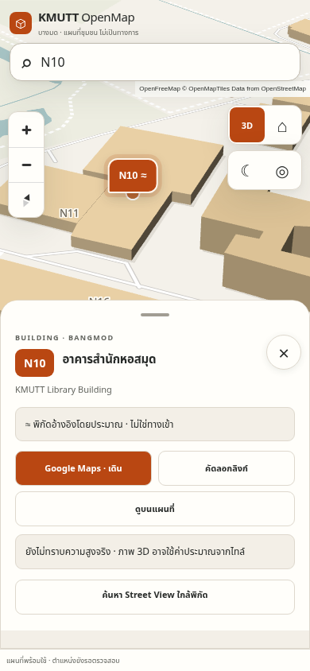

# KMUTT OpenMap — complete pre-launch release review

Prepared 4 November 2026 (Asia/Bangkok). Attribution: **Initiated by Firm Impulse · FIBO FRAB11**. The owner explicitly authorized self-review, corrections, merge, deployment and production verification. This supersedes the earlier instruction to stop at independent review; historical evidence remains unchanged.

## Upstream merge discovered on resumption

When work resumed, PR #16 was already merged by the owner. The accepted application merge is `2717eb0b8c2bebffa1195bb388db9add5737cae6`; current main was `0bd1de40dbb74e206595e1956e2eb039c46e792f`. The independent review and production evidence in [PRELAUNCH-VISUAL-INDEPENDENT-REVIEW.md](PRELAUNCH-VISUAL-INDEPENDENT-REVIEW.md) are retained. Main CI and Pages deployment both passed at that commit (runs [41714542118](https://github.com/Apichetfirm/KMUTT-OpenMap/actions/runs/41714542118) and [41714542306](https://github.com/Apichetfirm/KMUTT-OpenMap/actions/runs/41714542306)). The accepted candidate had 56 Node, 4 Python and 124 browser passes.

The upstream `35bc03e` correction already fixed the previously recorded Firefox clipping and portrait sheet paint escape. Those corrections are preserved. The expanded six-building regression subsequently found remaining long-name action clipping on Linux, so identity and actions are now grouped before secondary content in the short rail, while retaining the upstream paint containment and compact sizing. A focused follow-up completes the persistent production smoke gate, catalog regression, launch draft and this handoff, plus a small persistent unofficial-community subtitle for mobile. No duplicate redesign PR or duplicate geometry work is introduced.

## Baseline

- Production URL: https://apichetfirm.github.io/KMUTT-OpenMap/
- Main at the beginning of this pass: `6e410b7126ca6cbda2481c15a4aa2ccb88dd42b0`.
- PR: https://github.com/Apichetfirm/KMUTT-OpenMap/pull/16
- Original implementation: `823c3534888e2f12aca464d68259756f8468b707`, CI run 90 passed 56 Node, 4 Python and 120 browser tests.
- Current owner correction at audit start: `49fdb7be638645f612d99018aec10d2d2cf9b6d3`. It keeps attribution visible and moves supplementary card media; CI run 92 reported **123 browser passes and 1 failure** in Firefox short landscape. There were no open PR comments or review threads when inspected.
- Complete source diff, the owner correction, original before/after images and `PRELAUNCH-VISUAL-IMPLEMENTATION-REPORT.md` were reviewed before the release changes.

## Defects and corrections

| Priority | Finding | Resolution / evidence |
| --- | --- | --- |
| P1 | At 667×375 Firefox clipped the Google Maps button: only 72.34% was in the card viewport. | The owner fixed the original N16 case in `35bc03e`. The expanded six-building regression found 95.99% button intersection for a longer name in all four Linux projects (run 41776646235: 124 passed, 4 failed). Group full canonical identity and primary actions before confidence/evidence/media in short landscape; preserve 44px targets and the strict fully-visible/hit-testing assertions. |
| P1 release gate | The current head had failing CI; old passing results did not validate the owner correction. | Require a fresh full matrix on the final head. No bypass of checks or branch protections. |
| P2 | No exhaustive rendered-card identity regression covered every catalog record. | Add a browser audit of all 35 Thai/English names, codes, source URLs, uncertainty, missing media, safe external actions and disabled internal routes. |
| P2 | The previous Pages workflow ended after uploading, without opening the published app. | Add actual-production Chromium verification after deployment: compare published asset hashes with the source checkout, exercise critical journeys, retain screenshots and camera/health records. |
| Environment constraint | The managed instance returns HTTP 403 for GitHub Pages; no network configuration mutation tool is exposed. | Use the ordinary GitHub Actions deployment runner for browser verification of public production. Local proxy/network settings are preserved. A read-only baseline audit runs on the PR before merge. |

No canonical geometry, building name, floor count, height, image approval, entrance, route or data license was changed.

The next matrix (run 41778094447) passed 127 cases and exposed one Firefox failure after consecutive N9→N10 selection: the new short card could retain an anchored scroll offset. The detail panel now disables automatic scroll anchoring, constrains horizontal overflow with wrapping/shrinking flex text, and resets both scroll axes after rendering, focus and camera layout reads. A focused Firefox gate runs before the full matrix for faster feedback; the complete 128-case matrix remains mandatory. The fast Firefox gate then confirmed residual horizontal overflow. Compact media now has an explicit container-relative width and a zero minimum height/width, so its preferred aspect ratio cannot impose an oversized intrinsic width on a short rail. Flex text can shrink and wrap. The regression verifies both zero scroll origins and internal scroll width, includes target/panel/media geometry in failures, and keeps the fully-visible assertion unchanged.

## Implementation, visual and product review

Retain the warm architectural materials, opaque shaded provider polygons, restrained contact wash, daylight/dark interface, floating explorer, source-based labels, orange approximate markers, 16:9/generic media, and mutually exclusive portrait sheets. The map remains MapLibre and uses real provider geography. The generic illustration explicitly does not depict the selected building. The owner’s compact-layout and always-visible attribution work is retained. A persistent, compact unofficial-community subtitle now also appears on mobile, so first-time visitors can see the project status without opening Data & GIS.

The six priority identities are N9 Institute of Field Robotics / FIBO, N10 KMUTT Library, N11 School of Information Technology, N16 Learning Exchange / LX, N17 Classroom Building 2 and N20 Classroom Building 1. Production text is populated from canonical data, including all 35 records.

The deliberate second review covers source/DOM safety, shared URLs, source association, height classification, imagery eligibility, dependency scope, CSP, local storage compatibility, reduced motion, keyboard/touch sheet behavior, focus return, safe areas and responsive camera padding. Map controls covered by a full portrait sheet leave the tab order and return when it collapses. No new runtime dependencies, external fonts, AI inference, server, geometry engine or continuous rendering were added.

## Data and media integrity

The expected validated catalog remains 35 buildings, 20 approximate coordinate references and 15 records without coordinates. There are 18 unreviewed candidates; **0 accepted footprints, 0 surveyed footprints, 0 measured heights, 0 surveyed entrances and 0 verified internal routes**. N16 has a documented floor count of 15, without a measured meter height. The 73 OSM services are not newly verified. Internal/wheelchair routing stays disabled.

There are no approved building photographs in the current media index. Existing licensing, attribution, source, review and lazy-loading checks remain intact. Missing images do not block an honestly labeled community preview. No Google imagery was scraped or rehosted. Discovery did not establish a new independently approved reusable photograph; none was fabricated or published.

## Validation and evidence

Fresh local checks: 56 Node and 4 Python tests passed; data/media/vendor checks and the static build passed; npm audit reported 0 vulnerabilities. Six focused desktop/mobile landscape/card/sheet regressions passed. The production smoke script rehearsal passed all 13 checks against the actual local app and provider, with no map/data/provider fixtures. Final-head CI then passed 56 Node, 4 Python, 128 browser cases and one focused Firefox preflight, with 0 failures. Both JavaScript and offline image dependency audits reported no known vulnerabilities. Local Chromium is available; local Firefox/WebKit downloads remain disallowed, so their execution is verified in CI.

The completed full browser matrix contains 128 cases across Chromium desktop/mobile, Firefox and WebKit. The focused Firefox preflight repeats one critical case before that full matrix; it is not a 129th unique case. Required layouts: 360×640, 390×844, 667×375, 768×1024 and 1440×900. Node and Python totals remain 56 and 4. Evidence: [final candidate CI 41780170906](https://github.com/Apichetfirm/KMUTT-OpenMap/actions/runs/41780170906), exact head `b050e06e74f3c78a32ce4d367425072493d8587f`.

Production verification uses no basemap, catalog, media or provider fixtures. Its only module hook exposes the live map for camera recording and recovery inspection after checking the unmodified module hash. Sharing exercises the application’s clipboard-unavailable fallback. External directions record the native `window.open` target while a real popup opens; Google’s subsequent document load/redirect is outside the application contract; no claim is made about Google’s route accuracy or Street View image coverage.

## Reproduced performance

Six alternating pairs, fresh browser contexts, 1440×900, one sandboxed headless Chromium process with software SwiftShader, actual provider responses through the session proxy. No other QA browser was running during these samples. Baseline is `6e410b7`; final app source hashes are in [release-performance.json](prelaunch-visual/release-performance.json). Historical measurements are retained independently.

Observed median map readiness: **2522.40 ms baseline → 2312.95 ms release**. Resource entries remain 32 and the canvas count remains 1. Median observable transfer is 2,067,752 → 2,080,351 bytes. Median synchronous search is 0.45 → 0.60 ms. Coarse JS heap is 26,385,482 → 20,256,782 bytes; long-task totals are 2158.5 → 1801.5 ms. No sample timed out or reported an application error. This shows no material startup regression in this sample, not a causal speedup or physical-device result. Cross-origin wire bytes and GPU/process memory are not fully observable.

[release-interactions.json](prelaunch-visual/release-interactions.json) records detail-render observations of 5.8–49.4 ms desktop and 6.8–30.6 ms at a mobile-sized viewport. Camera settling, including a 250ms quiet guard, ranged 1494.9–1610.1 ms desktop and 1286.4–1545.0 ms mobile. Headless software animation callbacks are recorded as observations, not a 60 FPS, physical-phone, battery or thermal claim.

## Release state

**Release: Complete. Deployment: Verified. Facebook launch: Ready for the owner to post.** No unresolved P0/P1 defect remains in the tested release.

- [PR #16](https://github.com/Apichetfirm/KMUTT-OpenMap/pull/16): merged at `2717eb0b8c2bebffa1195bb388db9add5737cae6`.
- [PR #17](https://github.com/Apichetfirm/KMUTT-OpenMap/pull/17): merged normally after the exact head passed CI, with no protection bypass or unresolved review thread.
- Final application release on main: [`1fc004883a8bbb13e947193b135779baa74176c5`](https://github.com/Apichetfirm/KMUTT-OpenMap/commit/1fc004883a8bbb13e947193b135779baa74176c5). The subsequent documentation-only commit preserves this application source; its SHA is identified by this file's [commit history](https://github.com/Apichetfirm/KMUTT-OpenMap/commits/main/docs/PRELAUNCH-COMPLETE-RELEASE-REPORT.md) and the final handoff.
- [Pages deployment and actual production verification 41781070544](https://github.com/Apichetfirm/KMUTT-OpenMap/actions/runs/41781070544): **success**, with expected commit `1fc004883a8bbb13e947193b135779baa74176c5`.
- [Live application](https://apichetfirm.github.io/KMUTT-OpenMap/): all **13 production smoke checks passed, 0 failed**. All **37 inspected app/data/vendor/document assets matched SHA-256** from the merged checkout. Chromium 156.0.8078.4 on the ordinary Ubuntu 22.04 Actions runner rendered the actual public MapLibre scene. No application, console or CSP error was recorded.
- [Raw public release results](prelaunch-visual/release-production-smoke.json) retain the exact commit, source hashes, all 35 identities, five viewports, eight screenshot/camera records, checks and browser health. The deployment artifact `production-smoke-1fc004883a8bbb13e947193b135779baa74176c5` retains the actual public-site PNGs for 30 days; repository launch PNGs remain durable.
- Before merging, the [read-only public baseline](prelaunch-visual/release-production-baseline.json) passed **5 checks, 0 failed**, with **35 assets matching** base `0bd1de40dbb74e206595e1956e2eb039c46e792f`. The reference website also loaded successfully on that runner; its screenshot is in the baseline artifact. Local Pages/benchmark access remained denied by the managed proxy.

The 13 public checks cover source equality, homepage/WebGL, all canonical identities and uncertainty, 2D/3D, dark/daylight, Street View search, actual external Google Maps popup target, production sharing fallback, community form entry, disabled internal routing/empty accepted geometry, responsive sheet keyboard/inert behavior, map recovery and runtime/CSP health. Public checks do not submit a community proposal or confirm a third-party walking route/Street View panorama.

The evidence-only documentation successor runs through the same deployment and verification workflows, including hash verification of this report and the launch draft. The final handoff records its exact SHA and observed results; [main CI history](https://github.com/Apichetfirm/KMUTT-OpenMap/actions/workflows/test.yml?query=branch%3Amain) and [Pages history](https://github.com/Apichetfirm/KMUTT-OpenMap/actions/workflows/pages.yml?query=branch%3Amain) retain the corresponding checks. Application evidence above remains pinned to its actual release commit.

## Screenshots and launch draft

Historical before/after evidence: `docs/prelaunch-visual/before-*.png`, original `launch-*.png`, `cameras.json`, `browser-health.json` and `performance.json`. These are retained without overwriting them.

New actual-app launch candidates: `release-campus-overview.png`, `release-building-n16.png`, `release-mobile.png` under `docs/prelaunch-visual/`, with a separate release camera/health record. Production workflow evidence additionally retains public-site PNGs, source hashes, exact expected commit, camera parameters and browser results as GitHub Actions artifacts.

| Scene | Before | Release |
| --- | --- | --- |
| Campus overview | [Original](prelaunch-visual/before-campus-overview.png) | [Release overview](prelaunch-visual/release-campus-overview.png) |
| N16 detail | [Original](prelaunch-visual/before-building-n16.png) | [Release N16](prelaunch-visual/release-building-n16.png) |
| Mobile | [Original](prelaunch-visual/before-mobile.png) | [Release mobile](prelaunch-visual/release-mobile.png) |

Thai Facebook draft: [FB-LAUNCH-COPY-TH.md](FB-LAUNCH-COPY-TH.md). The owner will post it; no automatic Facebook publication is performed.

## Accessibility and second-pass self-review

Before submission, a separate pass verified that the UI corrections preserve the existing CSP exactly, add no runtime dependencies/remote fonts, and leave canonical data byte-for-byte unchanged. New workflows retain pinned actions, read-only repository access for CI, and the existing Pages-only deployment permissions. No status checks or branch protections are bypassed. Production observations retain no location or private evidence.

Existing palette contrast observations remain applicable: white/orange 5.29:1; light primary/surface 14.18:1; light secondary/surface 5.94:1; dark primary/surface 11.80:1. Thai line height, keyboard snap equivalents, focus restoration and reduced motion remain intact. Portrait touch controls are 44px; compact landscape map zoom controls are 34px, above the WCAG 2.2 AA minimum of 24px and below the preferred 44px. Physical assistive-technology verification is not claimed.

Confirmed P0 findings: none. The confirmed short-landscape P1 and portrait paint P1 were fixed upstream and passed candidate CI before PR #16 merged. This follow-up preserves those accepted fixes. The expanded Linux check found and corrected an additional long-name clipping P1, without shortening canonical names or weakening tests. Its final 128-case matrix and focused Firefox gate passed before merging. Missing surveys/photos and physical-device measurements remain documented preview limitations, not automatic blockers.

## Remaining limitations and post-launch priorities

Field surveys and independent geometry/code association remain needed. Physical-device GPU, battery, thermal and assistive-technology testing are not claimed. Provider tile/glyph/sprite availability is outside the application’s control. Approximate destinations may differ from entrances, imagery may be missing, and source names may retain documented conflicts. These do not become verified because software tests pass.

Recommended next work: lawful independently reviewed campus photography; field verification of the six priority buildings and public entrances; physical-phone usability and accessibility sessions; then evidence-based footprint/height and pedestrian-route acceptance. Preserve clear reporting, source attribution and the unofficial community-preview notice throughout.
